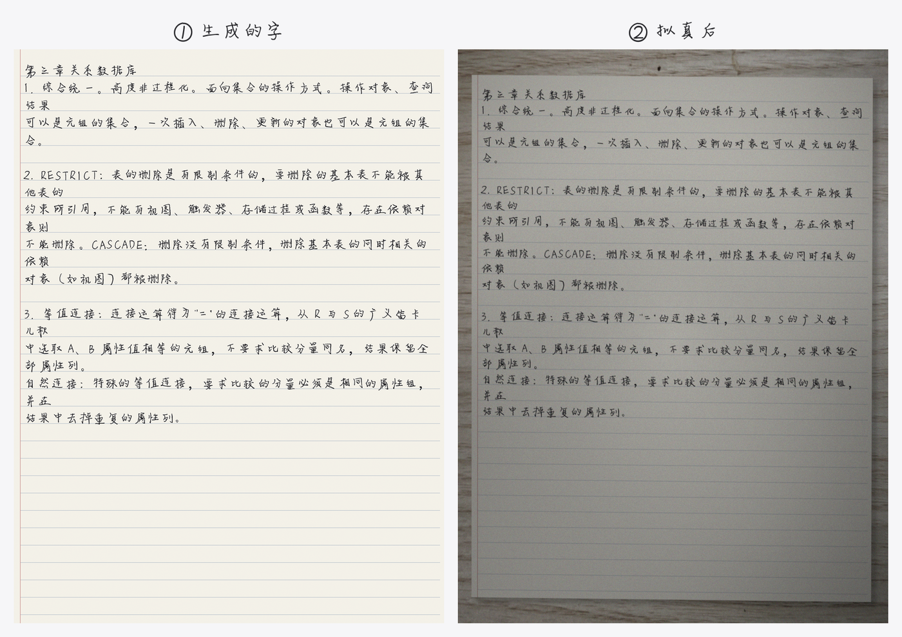
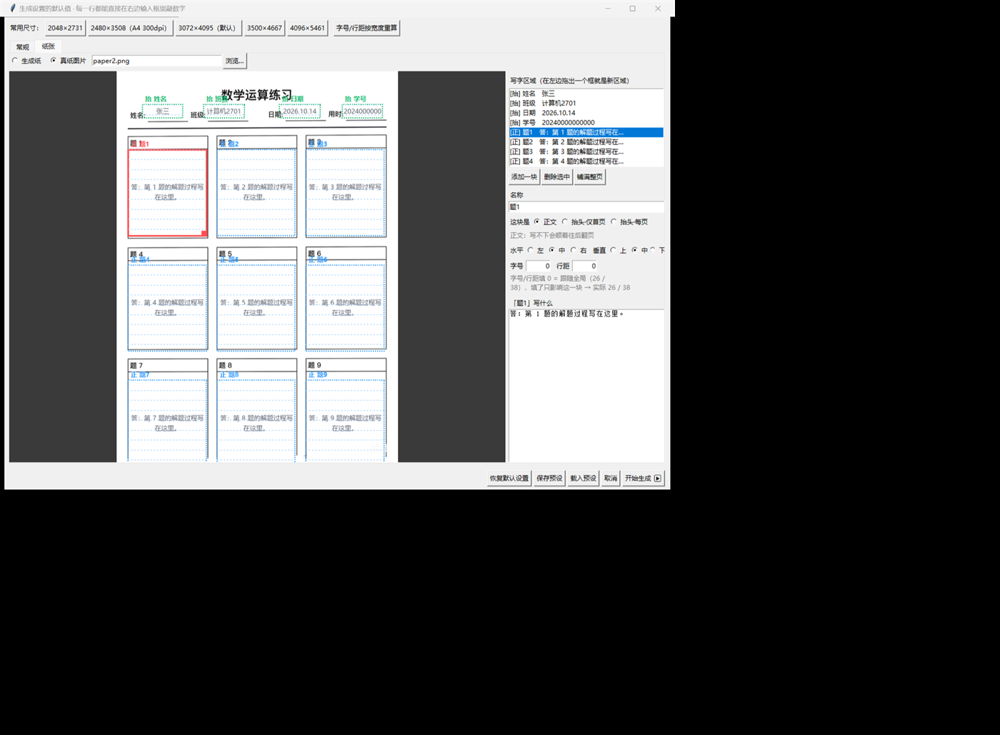
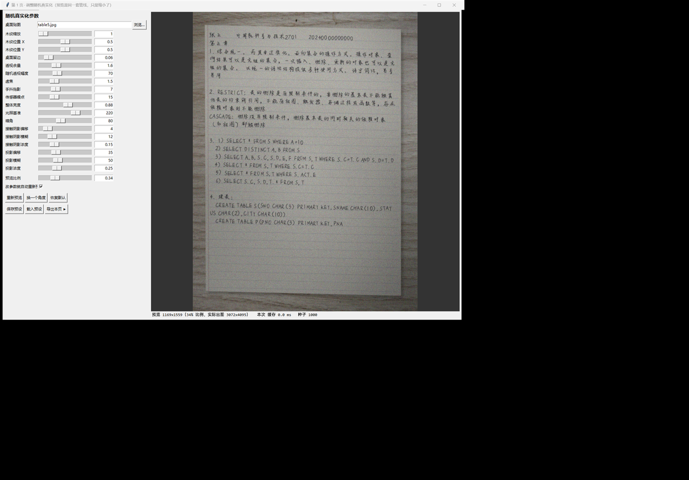
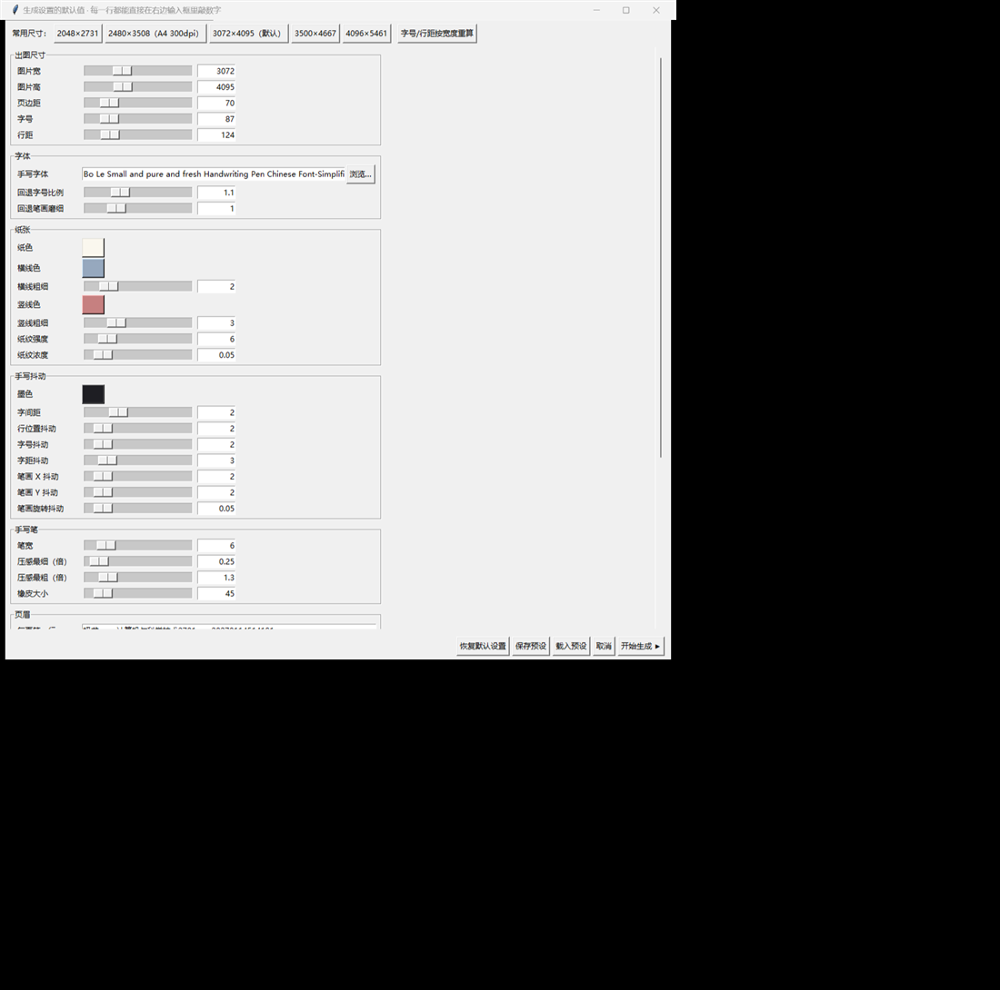
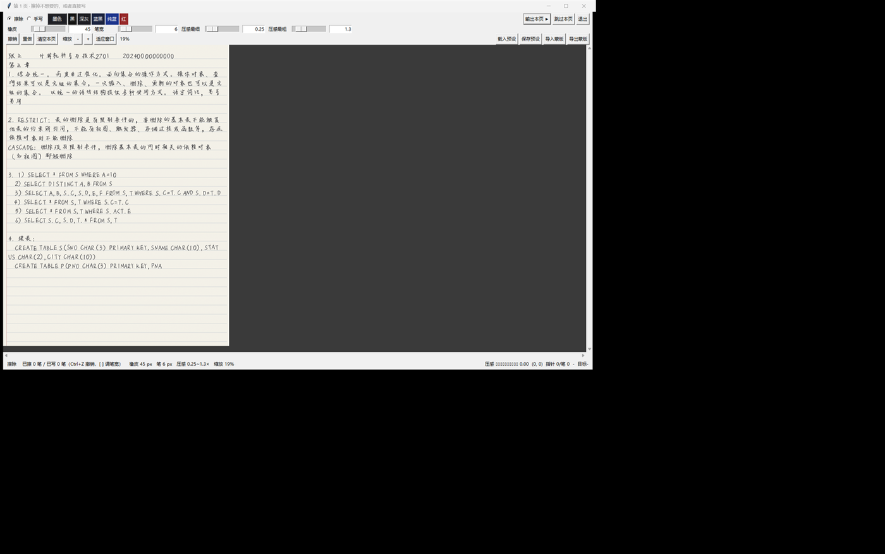

# handright-photo

用 [Handright](https://github.com/Gsllchb/Handright) 生成中文手写，再把它**做成一张"拍出来的照片"**。

纸上会带上透视、投影、光照、暗角和传感器噪点，背景是木纹桌面 —— 出来的图不是"电子手写体"，而像手机随手拍的一张作业。全程有图形界面：改参数、擦掉不想要的地方、自己用数位笔补几笔，都能在窗口里做完再出图。

> 已有不少 Handright 的 GUI，但基本都停在"把字渲染到纸上"这一步。这个项目的重点在后面：**拟真化**，以及围着它做的整套编辑流程。



---

## 目录

- [和别的 Handright GUI 有什么不一样](#和别的-handright-gui-有什么不一样)
- [安装](#安装)
- [使用](#使用)
- [参数怎么调](#参数怎么调)
- [目录结构](#目录结构)
- [常见问题](#常见问题)
- [致谢与许可](#致谢与许可)

---

## 和别的 Handright GUI 有什么不一样

**1. 拟真化处理（这是重点）**
`opencv_photo_like()` 走一条完整的"翻拍"管线：

```
纸 → 贴到木纹桌面 → 接触阴影 + 定向投影 → 整体透视 → 裁剪
   → 失焦 + 手抖拖影 → 光照不均 + 暗角 → 传感器噪点
```

想要多像就有多像，参数全部可以在界面上实时看着调。

**2. 纸可以是真的**
不想用合成的网格纸？把**自己学校的作业纸扫一张 / 拍一张**丢进去，在预览图上**拖出写字区域**：



- 一块区域 = 纸上的一个矩形 + 一段正文，每块**各自排版、各自翻页**
- 抬头（姓名/班级/学号/日期…）就是个区域，拖到纸印好的下划线上
- 每块能单独设**字号 / 行距 / 对齐**（靠上居中靠下、靠左居中靠右）
- 每块能设成三种**抬头模式**（见下），也可以当正文用
- 一块写不下会自动翻到下一页的同一位置
- 区域里画了行位置虚线，照着对纸上的行距
- **预览直接用普通字体把字排出来**，改字号/对齐立刻看得见，不用先出图

| 这块是 | 行为 |
|---|---|
| **正文** | 写不下就顺着往后翻页 |
| **抬头·仅首页** | 只在第 1 页出现，翻页后不再写 |
| **抬头·每页** | 每一页的同一位置都写一遍（适合学号这种每页都要的） |

**3. 三个窗口，完整流程**

| 窗口 | 干什么 |
|---|---|
| **设置** | 出图尺寸、字体、手写抖动、手写笔、正文；**「纸张」页**选真纸/生成纸并拖出写字区域 |
| **逐页编辑** | 像 PS 蒙版一样擦掉不想要的字，或直接用数位笔手写补几笔 |
| **调参** | 透视 / 阴影 / 光照 / 噪点 / 桌面贴图，缩小预览实时看效果 |

<p align="center">
  
  
</p>

<p align="center">
  
</p>

**4. 真·压感手写**
用 Windows 的 `WM_POINTER` 直接拿压感，**不用装任何驱动**，Wacom / Windows Ink 的笔插上就能用，笔迹粗细随力度变化，颜色和生成的字完全一致。也支持鼠标（无压感）。

**5. 蒙版可以导出到 PS 里改**
导出成 PNG（白=有墨），在 Photoshop 里把不想要的字涂黑，再导回来 —— 逐像素一致。

**6. 参数记住 + 预设**
改过的设置自动记住；三套界面都能把参数存成 `.json` 预设，换作业直接载入。

---

## 安装

### 1. Python

**3.9 或更高**（实测 3.9.13）。tkinter 是标准库自带的，Windows 上用 [python.org](https://www.python.org/downloads/) 的安装包默认就装了，**不需要额外装**。

```bash
git clone https://github.com/<你的用户名>/handright-photo.git
cd handright-photo
```

### 2. 依赖

建议用虚拟环境：

```bash
python -m venv .venv
.venv\Scripts\activate          # Windows
# source .venv/bin/activate     # macOS / Linux

pip install -r requirements.txt
```

`requirements.txt` 的内容：

```
handright==8.2.0
Pillow>=10.0
numpy>=1.24
opencv-python>=4.8
```

> 实测通过的组合：`handright 8.2.0` + `Pillow 10.4.0` + `numpy 2.0.2` + `opencv-python 5.0.0.93`。

### 3. 字体（必须自己准备）

把**中文手写体 `.ttf`** 放到项目根目录，然后在设置界面的「手写字体」里选中它（或者直接改 `deal.py` 里的 `DEFAULTS["font_path"]`）。

仓库里**没有附带字体**，原因见[致谢与许可](#致谢与许可)。

### 4. 桌面贴图（可选）

`table2.jpg` 之类的木纹图会被当成桌面背景，越大越清晰。仓库里带了几张 512×512 的小图够用；想要更清晰就自己换一张大图（设置界面 →「桌面贴图」→ 浏览…）。

---

## 使用

### 出图：`deal.py`

```bash
python deal.py
```

会依次弹出三个窗口：

1. **设置界面** — 改尺寸 / 字体 / 正文，点「开始生成 ▶」
2. **逐页编辑** — 每一页生成后弹出来。可以直接「输出本页 ▶」跳过，也可以擦掉或手写补几笔
3. **调参界面** — 第一页编辑完之后弹出来调拟真参数，点「导出本页 ▶」

出图保存在 `output_images/`。

**逐页编辑窗口速查**

| 操作 | 说明 |
|---|---|
| 左键拖动 | 按当前工具（擦除 / 手写）画 |
| `[` `]` | 调笔宽 / 橡皮大小 |
| `Ctrl+Z` / `Ctrl+Y` | 撤销 / 重做 |
| `＋` `－` | 缩放（**拖到 100% 也不卡**，重画是按图块走的） |
| 导入 / 导出蒙版 | 和 Photoshop 来回倒 |
| 输出本页 / 跳过本页 / 退出 | 控制流程 |

**批量出图（不要界面）**

```bash
set HANDWRITE_SETTINGS=0      # Windows
# export HANDWRITE_SETTINGS=0 # macOS / Linux
python deal.py
```

再配合 `deal.py` 里 `DEFAULTS` 的 `interactive = False`、`tune_photo = False`，就是纯命令行批量跑。

### 压缩：`compress.py`

生成出来的是 3072×4095 的 PNG，一张好几 MB。`compress.py` 把它们压到指定大小以内：

```bash
python compress.py
```

```python
# compress.py 顶部可调
INPUT_DIR  = "output_images"       # 输入
OUTPUT_DIR = "compressed_images"   # 输出
MAX_SIZE_BYTES = 2 * 1024 * 1024   # 目标 2 MB
MIN_QUALITY = 30                   # 质量下限，再低就改缩分辨率
```

思路是**先降 JPEG 质量，降到 30 还不够就缩分辨率**，循环到小于目标大小为止。输出统一是 `.jpg`。

---

## 参数怎么调

绝大多数参数在三个界面里都能拖，这里只说几个容易踩坑的：

| 参数 | 在哪 | 说明 |
|---|---|---|
| `DESK_MARGIN` | 调参界面 | **看得见的**桌面留边。0 = 出图正好是一张纸 |
| `BG_SCALE` | 调参界面 | 透视余量，只影响透视有没有地方变形，**不改变构图** |
| `WOOD_ZOOM` | 调参界面 | 木纹放大倍数。**源图小的话会被拉糊**，512×512 拉到 5500 宽就是 10.8 倍 |
| `PERSPECTIVE_OFFSET` | 调参界面 | 透视幅度。现在是"相机略微转了一下"的模型：对边会朝消失点收敛，**不是平行四边形** |
| `motion_blur_size` | 调参界面 | 手抖拖影。**调太小会没有效果**（核被旋转推出边界时会自动跳过） |
| `blocks` | 设置 → 纸张 | 写字区域。**高度不能小于行距**、**行距不能小于字号**，界面和出图两处都会拦 |
| `pen_width` | 逐页编辑 | 手写笔的基准宽度。和字号是**两个独立参数**，互不影响 |
| `page_header` | 设置 → 常规 | 不分区域时，每页第一行写这个 |

> `page_header` 和 `blocks` 二选一：**一旦定义了写字区域，「常规」页的正文框会置灰**，
> 正文改由各区域的「这一块写什么」决定；抬头那时应该是其中一块区域，自己拖到纸上印好的下划线上。

---

## 目录结构

```
deal.py              主流程：配置默认值 + 拟真化管线 + 主程序
compress.py          把出图压到指定大小

settings_editor.py   窗口① 生成设置（尺寸/字体/正文/预设）
paper_tab.py         窗口① 的「纸张」页：真纸 / 生成纸 / 拖出写字区域
mask_editor.py       窗口② 逐页编辑（擦除/压感手写/蒙版/缩放）
photo_editor.py      窗口③ 拟真参数（透视/阴影/光照/桌面/预览比例）
param_widgets.py     三个窗口共用的参数行控件（滑块 + 手动输入）

pen_pointer.py       WM_POINTER 压感后端（Windows）
wintab.py            WinTab 后端（实测在这台机器上不可用，默认关闭）

editor_selftest.py       编辑器自检
render_selftest.py       排版自检（多区域渲染、翻页、和旧行为等价）
paper_tab_selftest.py    「纸张」页交互自检
pen_pointer_test.py      独立的 pointer 诊断窗口，压感不灵时用
```

---

## 常见问题

**Q：装不上 / 连不上 PyPI**
`pip install handright -i https://pypi.tuna.tsinghua.edu.cn/simple` 换国内源试试。

**Q：压感没反应**
先跑 `python pen_pointer_test.py`，它会显示指针消息有没有进来。状态栏那行 `指针 N/笔 M` 里 `笔` 一直是 0，说明系统没把笔当笔报。

**Q：生成的字里有空白方块**
主字体缺那个符号。`DEFAULTS["fallback_fonts"]` 里配了回退字体（Cambria Math 等）来补，缺什么符号往里面加。

**Q：出图很慢**
拟真化一步大约 4 秒（透视那步的工作画布有 3200 万像素）。调参界面里把「预览比例」调小可以快很多。

**Q：调参界面一片黑**
`motion_blur_size` 缩到 2 左右时，旋转后的模糊核可能什么都不剩。代码里遇到这种情况会跳过这一步，如果还黑请提 issue。

**Q：改了小字号就报 `font size must be greater than 0`**
那是 handright 自己的小 bug（`_get_font` 把随机抖动夹到了 `max(..., 0)`）。仓库里已经打了补丁夹到 1，见到这个报错说明你用的不是本仓库的 `deal.py`。

**Q：纸张页里改字号，字没跟着变**
预览里的字是**用普通系统字体**画的（不是手写体），只为了看大小和位置。真正的手写体在出图时才渲染。如果连普通字体都没显示，多半是系统里缺 `msyh.ttc / simhei.ttf / simsun.ttc`。

---

## 致谢与许可

本项目基于 [Handright](https://github.com/Gsllchb/Handright)（BSD-3-Clause，作者 Gsllchb）—— 排版和笔迹抖动全部由它完成，这个仓库做的是拟真化处理、编辑界面和压感输入。

> ⚠️ **仓库里不包含字体和作业纸图片。** 中文手写体基本都是商业字体，学校抬头纸多半带校徽，
> 都不适合直接提交到公开仓库 —— `.gitignore` 里已经忽略了 `*.ttf / *.ttc / *.otf` 和 `paper*.*`，
> 使用者自己准备即可。
>
> 同理，`table*.jpg` 如果是网络下载的素材，也请确认授权；不确定的话换成自己拍的照片或 CC0 素材。

## 隐私提醒

`handwrite_settings.json`（自动记住的那份设置）里会有**你填的姓名、学号、正文**，
它已经在 `.gitignore` 里了。第一次提交前建议 `git status` 扫一眼，确认没把它和 `output_images/` 带进去。
